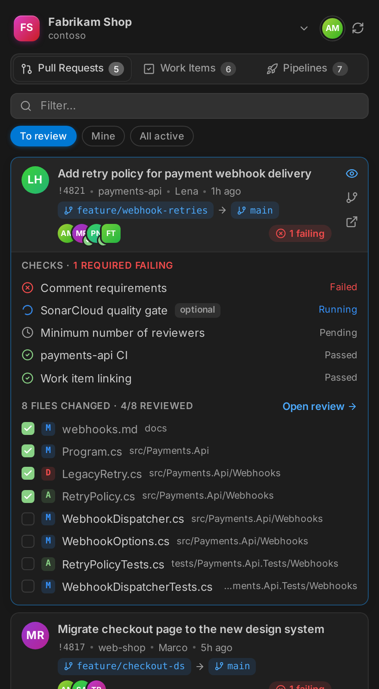
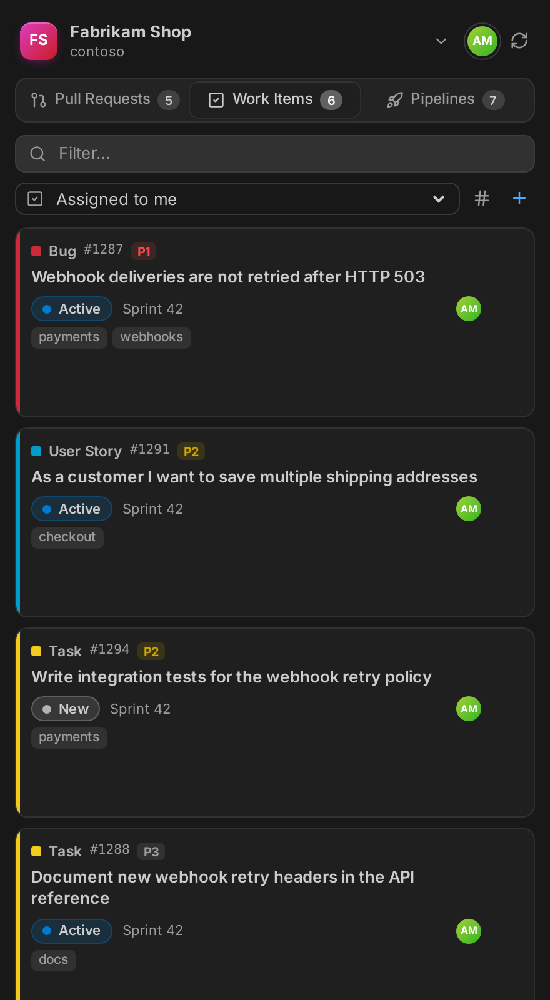
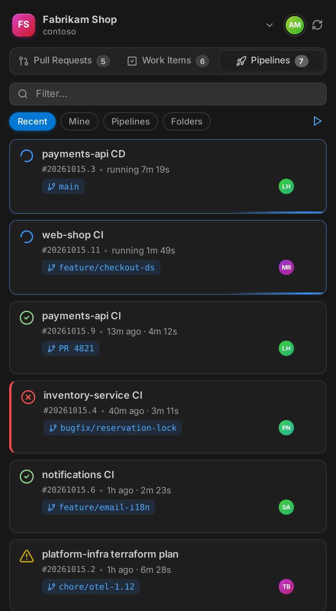
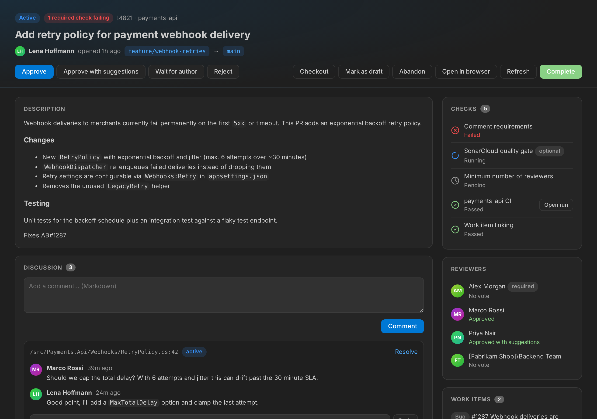
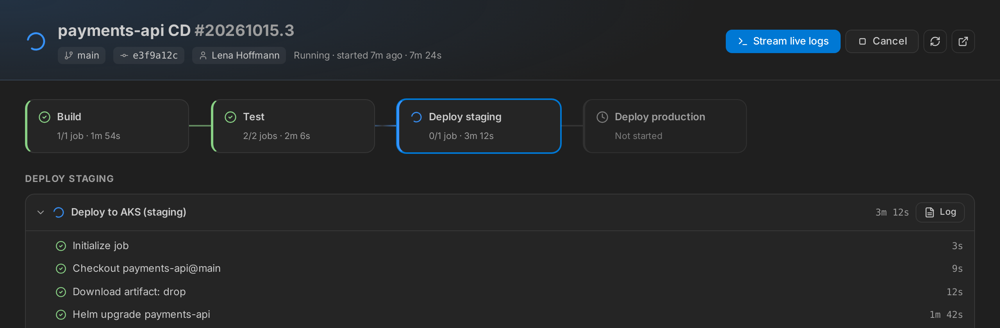

# DevOps Deck for Azure DevOps

Review pull requests, manage work items and watch pipelines with live logs, all without leaving VS Code.

> DevOps Deck is a community extension and is not affiliated with or endorsed by Microsoft.

## Features

### Dashboard

A sidebar with tabs for pull requests, work items and pipelines. It has search, filter chips, avatars and status badges, and it follows your VS Code theme.

<p align="center">
  
  
  
</p>

### Pull requests

- **Filters:** *To review*, *Mine* and *All active*. Each card shows the reviewers' votes.
- **Checks:** each card shows whether the required branch policies (builds, reviewers, comments, status checks) have passed, failed or are pending. Pull requests that are ready to merge (all required policies passed, no conflicts, not a draft) get a green border. Expand a card to see every policy, failing ones first, and click a build to open its run. The overview page shows the same list.
- **Native diffs:** expand a card to see the changed files and open any of them in VS Code's diff editor.
- **Inline comments:** read, reply, resolve and reactivate threads, and edit or delete your own comments. To start a new thread, use the **+** in the gutter, *Add Pull Request Comment* in the context menu, or <kbd>Ctrl</kbd>+<kbd>Alt</kbd>+<kbd>C</kbd>.
- **Code suggestions:** select lines and choose *Suggest a Change* (<kbd>Ctrl</kbd>+<kbd>Alt</kbd>+<kbd>S</kbd>). The comment is prefilled with a ```` ```suggestion ```` block. Edit the code and save; it then appears in Azure DevOps as a suggestion the author can apply.
- **Reviewed files:** check off files in the sidebar or from the diff editor's title bar, and track progress as *x/y reviewed*. A check mark disappears when a new push changes the file again.
- **Overview page:** description, discussion, reviewers and linked work items, which you can link and unlink here. Vote (*Approve*, *Approve with suggestions*, *Wait for author*, *Reject*), complete the PR with a merge strategy of your choice, switch draft/published, or abandon it.
- **Checkout:** switch to the source branch in your local repository.



### Work items

- Built-in queries plus all your saved queries (*My Queries* and *Shared Queries*).
- Change the state, assign to yourself, comment, create a branch, create a new work item, or open one by ID.
- A detail view with an editable title, a state picker, the description and the discussion.
- Linked pull requests with status, repository and branch. Link more by ID or title.

### Pipelines

- **Views:** *Recent*, *Mine*, *Pipelines* (every definition with its latest result) and *Folders* (browse pipeline folders with breadcrumbs and per-folder counts).
- **Run overview:** stages side by side, like in Azure DevOps, with jobs, steps, durations, errors and pending approvals. Click a step to open its log. Running pipelines refresh automatically.
- **Live logs:** stream a run's output into a colored terminal.
- **Run pipeline form:** pick the pipeline, a branch and optionally a commit, set **runtime parameters** read from the YAML (toggles, choices, numbers, text, objects) and override variables. You can also re-run or cancel runs.



### Watchers

Watchers check Azure DevOps in the background and tell you when something you care about happens, such as a new bug in your area, a work item moving to *Resolved*, a new pull request for you to review, or a vote on one of yours. They have their own **Watchers** section in the DevOps Deck sidebar, below the dashboard. It lists every watcher with its recent events and shows a badge for new ones; from there you can create, edit, pause or delete watchers. Creating or editing one opens an editor: choose what to watch, set filters, check them with *Test filter* against the current data, and pick the events and actions. The editor stores the watchers in `azureDevOps.watchers`, in your workspace settings if watchers are already defined there and in your user settings otherwise. You can also edit that setting directly:

```jsonc
"azureDevOps.watchers": [
  {
    "name": "New bugs for me",
    "type": "workItem",
    "where": "[System.WorkItemType] = 'Bug' AND [System.AssignedTo] = @Me",
    "events": ["created", "changed"],
    "fields": ["System.State", "System.AssignedTo"],
    "interval": 120
  },
  {
    "name": "Reviews for me",
    "type": "pullRequest",
    "reviewer": "@me",
    "events": ["created", "pushed"]
  },
  {
    "name": "Release PRs",
    "type": "pullRequest",
    "targetBranch": "release/*",
    "events": ["created", "voted", "completed"],
    "actions": ["notify", "open"]
  }
]
```

| Option | Applies to | Description |
|---|---|---|
| `name`, `type` | all | Name shown in notifications; `workItem` or `pullRequest` |
| `interval` | all | Seconds between checks, at least 60 (default 300) |
| `events` | all | Work items: `created`, `changed` (default both). Pull requests: `created` (default), `pushed`, `voted`, `completed`, `abandoned` |
| `where` | work items | Any WIQL condition; macros such as `@Me` and `@CurrentIteration` work |
| `fields` | work items | Report `changed` only when one of these fields changed; the notification then shows old → new values |
| `repository`, `targetBranch`, `sourceBranch` | pull requests | Repository name(s) and branches; `*` is a wildcard |
| `createdBy`, `reviewer` | pull requests | `@me`, a display name or an e-mail address |
| `titleContains`, `includeDrafts` | pull requests | Title filter; set `includeDrafts` to `false` to skip drafts |
| `ignoreOwnChanges` | all | Skip your own changes (default `true`) |
| `actions` | all | `notify` (default; notification with *Open* and *Open in Browser*), `open` (open it in VS Code), `browser`, or `{ "command": "…", "args": ["${id}", "${url}"] }` to run any VS Code command |

The status bar also shows how many events you have not looked at yet. Click it, or run *DevOps Deck: Show Watcher Events*, to see the last 50 events. More than three events from one check are combined into a single notification.

**Requests:** a work item watcher runs one query per check that only returns items changed since the previous check, and loads details only when something changed. All pull request watchers together use one request per check for the list of active pull requests and compare it with the previous one. When nothing has changed, a check costs one request per work item watcher plus one for all pull request watchers. Watchers start from the current state when VS Code starts, so changes made while VS Code was closed are not reported. Each open VS Code window runs its own watchers.

## Getting started

1. Open a folder whose git remote points to Azure Repos. DevOps Deck detects the organization and project from `dev.azure.com`, `*.visualstudio.com` and SSH remotes.
2. Open the **DevOps Deck** view in the Activity Bar.
3. Sign in with your Microsoft account when asked.

If there is no Azure Repos remote, or you want a different project, click the project name at the top of the sidebar. You can switch organizations and pick from all of the organization's projects. The choice is saved in the workspace settings and takes precedence over the git remote.

### Authentication

- **Microsoft account (default):** uses VS Code's built-in Microsoft sign-in (Entra ID). If the organization belongs to a different tenant than your account, set `azureDevOps.tenantId`.
- **Personal Access Token:** run *DevOps Deck: Use Personal Access Token*. The token needs these scopes: **Code** (Read & Write), **Work Items** (Read & Write) and **Build** (Read & Execute). It is stored in VS Code's secret storage.

## Settings

| Setting | Default | Description |
|---|---|---|
| `azureDevOps.organization` | *(detected)* | Organization name or URL, e.g. `contoso` or `https://dev.azure.com/contoso` |
| `azureDevOps.project` | *(detected)* | Project name |
| `azureDevOps.authMethod` | `microsoft` | `microsoft` or `pat` |
| `azureDevOps.tenantId` | | Entra ID tenant, if it differs from your account's home tenant |
| `azureDevOps.workItems.queries` | `[]` | Custom WIQL queries for the work item dropdown; these replace the built-in ones |
| `azureDevOps.refreshInterval` | `60` | Seconds between automatic refreshes of the visible sidebar tab, paused while VS Code is not focused (`0` = off) |
| `azureDevOps.pipelines.refreshInterval` | `10` | Seconds between refreshes while a run is in progress |
| `azureDevOps.pipelines.logPollInterval` | `3` | Seconds between polls when streaming logs |
| `azureDevOps.pipelines.showTimestamps` | `false` | Show timestamps in pipeline logs |

Example of a custom query:

```json
"azureDevOps.workItems.queries": [
  {
    "name": "Current sprint",
    "wiql": "SELECT [System.Id] FROM WorkItems WHERE [System.IterationPath] = @CurrentIteration('[Project]\\Team')"
  }
]
```

## Security and privacy

- Credentials are only ever sent to `https://dev.azure.com` and `https://*.visualstudio.com`. Requests to any other host are refused, even if a workspace's settings point elsewhere.
- In untrusted workspaces (see [Workspace Trust](https://code.visualstudio.com/docs/editor/workspace-trust)), the organization, project, tenant and query settings from the workspace are ignored.
- DevOps Deck collects no telemetry. Reviewed-file check marks are stored locally on your machine.

## Known limitations

- **Azure DevOps Server (on-premises) is not supported**, only Azure DevOps Services.
- **Live logs arrive per step, not line by line.** The public REST API only returns log lines once the agent uploads them, usually when a step finishes. Step status updates live, though. The web UI's line-by-line streaming uses an undocumented channel.
- **Reviewed-file check marks are not synced** with the check marks in the Azure DevOps web UI, because that storage is not a public API.

## Development

Requires Node.js 22 or later.

```bash
npm install
npm run compile
```

Press <kbd>F5</kbd> in VS Code to start an Extension Development Host. Build a `.vsix` with `npm run package`.

Run the unit tests with `npm test`, or `npm run test:coverage` to also write `coverage/lcov.info`. The tests use Node's built-in test runner and a small stand-in for the `vscode` module ([src/test/vscodeStub.ts](src/test/vscodeStub.ts)), so they run without starting VS Code.

## License

[MIT](LICENSE)
