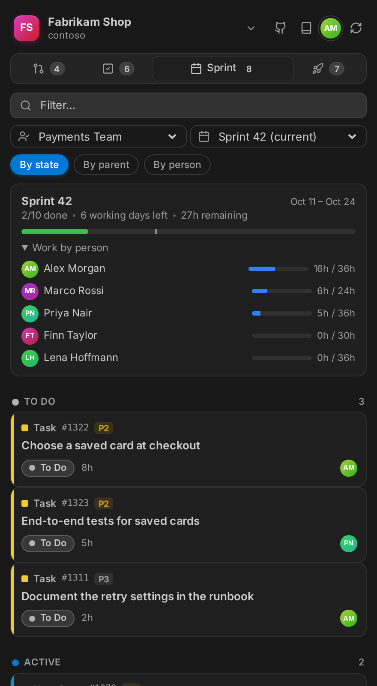
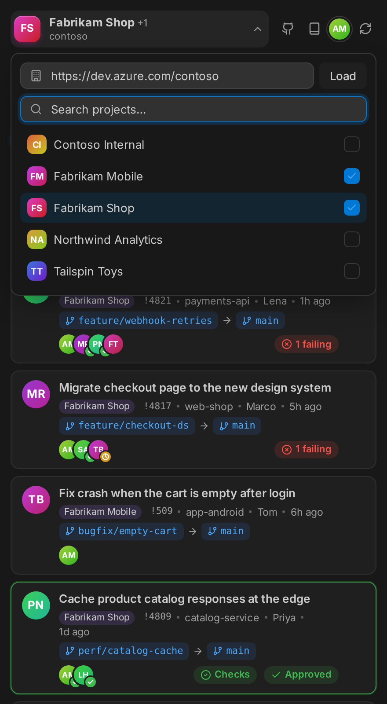
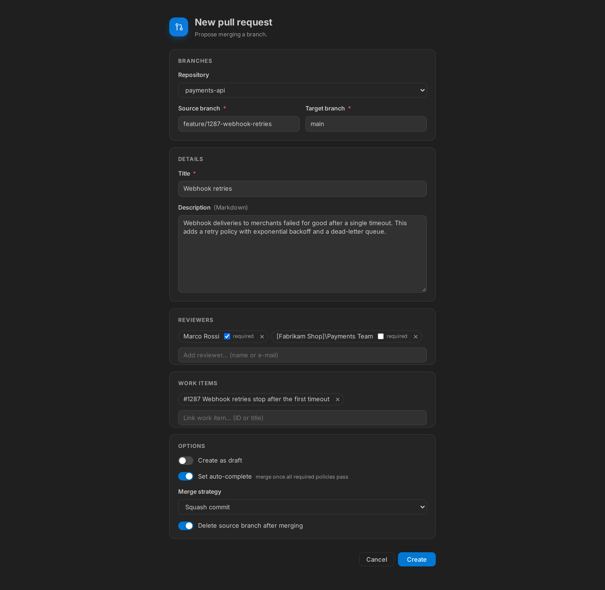
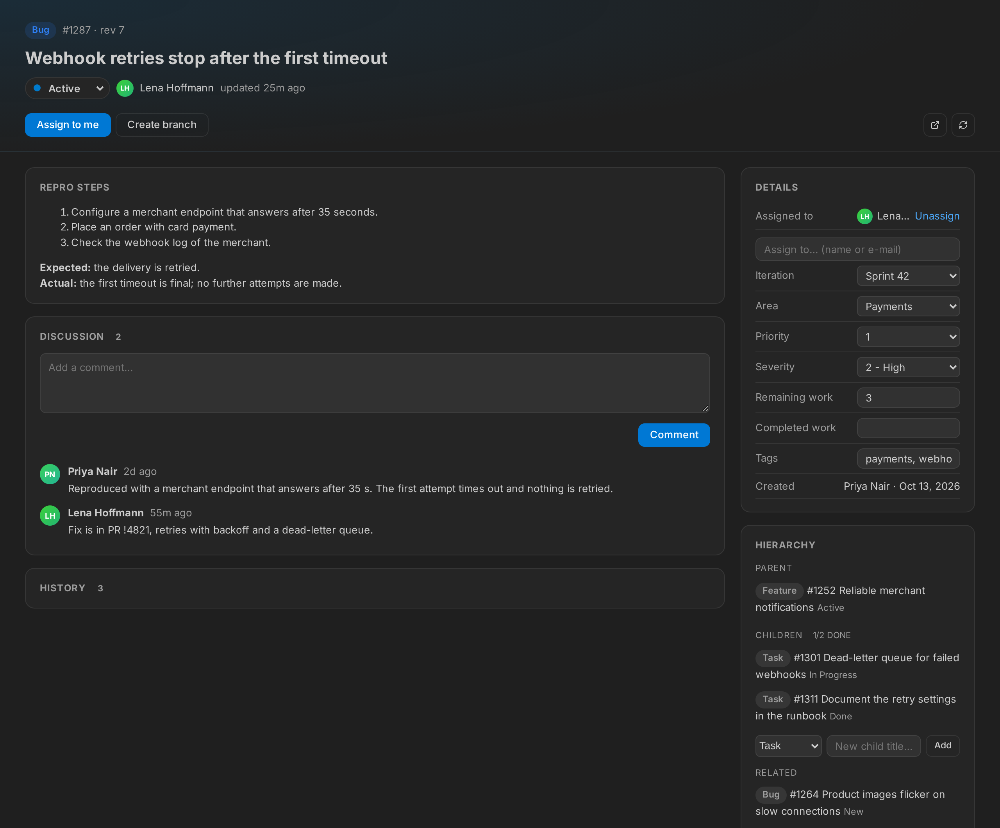
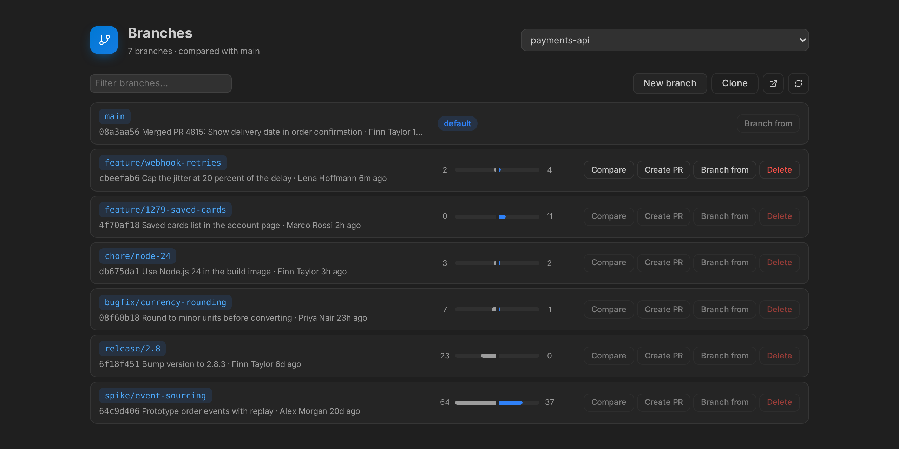

# DevOps Deck for Azure DevOps

Review and create pull requests, plan sprints, manage work items, watch pipelines with live logs, approve deployments and browse the wiki, all without leaving VS Code.

> DevOps Deck is a community extension and is not affiliated with or endorsed by Microsoft.

## Features

### Dashboard

A sidebar with tabs for pull requests, work items, the current sprint and pipelines. It has search, filter chips, avatars and status badges, and it follows your VS Code theme. Buttons at the top open repositories and the wiki.

<p align="center">
  
  
  
  
</p>

**Several projects at once:** in the project picker, tick more projects of the organization and choose *Show N projects*. Pull requests, work items, sprints, pipelines and approvals of all of them are then listed together, each card marked with its project. Clicking a project name still switches to just that project.

<p align="center"></p>

### Pull requests

- **Filters:** *To review*, *Mine* and *All active*. Each card shows the reviewers' votes.
- **Checks:** each card shows whether the required branch policies (builds, reviewers, comments, status checks) have passed, failed or are pending. Pull requests that are ready to merge (all required policies passed, no conflicts, not a draft) get a green border. Expand a card to see every policy, failing ones first, and click a build to open its run. The overview page shows the same list.
- **Native diffs:** expand a card to see the changed files and open any of them in VS Code's diff editor.
- **Inline comments:** read, reply, resolve and reactivate threads, and edit or delete your own comments. To start a new thread, use the **+** in the gutter, *Add Pull Request Comment* in the context menu, or <kbd>Ctrl</kbd>+<kbd>Alt</kbd>+<kbd>C</kbd>.
- **Code suggestions:** select lines and choose *Suggest a Change* (<kbd>Ctrl</kbd>+<kbd>Alt</kbd>+<kbd>S</kbd>). The comment is prefilled with a ```` ```suggestion ```` block. Edit the code and save; it then appears in Azure DevOps as a suggestion the author can apply.
- **Reviewed files:** check off files in the sidebar or from the diff editor's title bar, and track progress as *x/y reviewed*. A check mark disappears when a new push changes the file again.
- **Overview page:** description, discussion, reviewers and linked work items, which you can link and unlink here. Vote (*Approve*, *Approve with suggestions*, *Wait for author*, *Reject*), complete the PR with a merge strategy of your choice, switch draft/published, or abandon it.
- **Reviewers and auto-complete:** add people or groups as optional or required reviewers, remove reviewers, and set or cancel auto-complete so the PR merges as soon as all required policies pass.
- **Updates and commits:** every push to the PR is listed as an update. Open the files of one update, or all changes since your last visit, in the diff editor. The overview tells you how many updates are new since you last looked. The commits of the PR are listed too.
- **Create pull requests:** *Create Pull Request* (also in the PR tab and the status bar) prefills repository, source and target branch, a title and description from the branch's commits, and work items mentioned in the branch name or commits (`feature/1234-…`, `#1234`, `AB#1234`). Add reviewers, create it as a draft or with auto-complete. A branch that is not pushed yet is pushed first.
<p align="center"></p>

- **Status bar:** shows the pull request of the checked-out branch with the state of its required checks and approvals, plus the latest pipeline run of the branch. Without a PR it offers *Create PR*.
- **Checkout:** switch to the source branch in your local repository.


### Work items

- Built-in queries plus all your saved queries (*My Queries* and *Shared Queries*).
- Change the state, assign to yourself, comment, create a branch, create a new work item, or open one by ID.
- A detail view with an editable title, a state picker, the description and the discussion.
- **Edit fields:** assign to anyone (people search), and change iteration, area, priority, severity, story points or effort, remaining and completed work, and tags. Only the fields the work item type has are shown.
- **Hierarchy:** parent, children (with how many are done) and related items. Add a child task right there; it gets the same area and iteration.
- **History:** who changed which field from what to what, and which links were added or removed.
- Linked pull requests with status, repository and branch. Link more by ID or title.
- **From code:** select code, or put the cursor on a comment with `TODO`, `FIXME`, `HACK` or `BUG`, and choose *Create Work Item from Code* (context menu or light bulb). The title comes from the comment, the description holds the code and a link to the lines in Azure Repos. A comment gets the new ID added, so it is not reported twice.



### Sprint

The *Sprint* tab shows a team's sprint: dates, working days left, progress against elapsed time, and the remaining work per person compared with their capacity (when the team plans capacity). Group the items by state, by parent backlog item or by person. Pick another team or a past or future sprint at the top.

### Pipelines

- **Views:** *Recent*, *Mine*, *Pipelines* (every definition with its latest result) and *Folders* (browse pipeline folders with breadcrumbs and per-folder counts).
- **Run overview:** the stage graph like in Azure DevOps. Stages that run in parallel sit in the same column, and lines show the real `dependsOn` relations. They are read from the run's expanded YAML; for classic pipelines they are inferred from the stage times. Jobs, steps, durations and errors are listed below; running pipelines refresh automatically.
- **Logs in the overview:** click a step or *Log* on a job to read its log next to the steps, with filtering and *Follow* for running steps. This works the same for finished runs. Failed steps open by themselves.
- **Approvals:** stages waiting for an approval show *Review*; approve or reject with a comment. The *Approvals* filter in the Pipelines tab lists every pending approval.
- **Re-run stages:** rerun the failed jobs (or all jobs) of a failed or canceled stage.
- **Tests and artifacts:** the overview lists test runs and, on demand, the failed tests with error message and stack trace. *Artifacts* downloads a run's artifacts as zip.
- **Live logs:** stream a run's output into a colored terminal.
- **Run pipeline form:** pick the pipeline, a branch and optionally a commit, set **runtime parameters** read from the YAML (toggles, choices, numbers, text, objects) and override variables. You can also re-run or cancel runs.


### Repositories and wiki

- **Repositories and branches:** every branch with how far it is ahead of and behind the default branch, its last commit and author. Compare a branch with the default branch file by file in the diff editor, create a pull request, create or delete branches on the server, check a branch out, or clone the repository.
- **Wiki:** *Open Wiki Page* searches the page titles of the project wiki. Enter shows the rendered page, the pencil opens it as Markdown; saving writes it back. If someone else changed the page meanwhile, saving is refused instead of overwriting their change. You can also create pages.



### Watchers

Watchers check Azure DevOps in the background and tell you when something you care about happens, such as a new bug in your area, a work item moving to *Resolved*, a new pull request for you to review, a vote on one of yours, or a failed pipeline run on `main`. They have their own **Watchers** section in the DevOps Deck sidebar, below the dashboard. It lists every watcher with its recent events and shows a badge for new ones; from there you can create, edit, pause or delete watchers. Creating or editing one opens an editor: choose what to watch, set filters, check them with *Test filter* against the current data, and pick the events and actions. The editor stores the watchers in `azureDevOps.watchers`, in your workspace settings if watchers are already defined there and in your user settings otherwise. You can also edit that setting directly:

```jsonc
"azureDevOps.watchers": [
  {
    "name": "New bugs for me",
    "type": "workItem",
    "where": "[System.WorkItemType] = 'Bug' AND [System.AssignedTo] = @Me",
    "events": ["created", "changed"],
    "fields": ["System.State", "System.AssignedTo"],
    "interval": 120
  },
  {
    "name": "Reviews for me",
    "type": "pullRequest",
    "reviewer": "@me",
    "events": ["created", "pushed"]
  },
  {
    "name": "Release PRs",
    "type": "pullRequest",
    "targetBranch": "release/*",
    "events": ["created", "voted", "completed"],
    "actions": ["notify", "open"]
  },
  {
    "name": "Broken main",
    "type": "pipeline",
    "branch": "main",
    "events": ["failed"]
  }
]
```

| Option | Applies to | Description |
|---|---|---|
| `name`, `type` | all | Name shown in notifications; `workItem`, `pullRequest` or `pipeline` |
| `interval` | all | Seconds between checks, at least 60 (default 300) |
| `events` | all | Work items: `created`, `changed` (default both). Pull requests: `created` (default), `pushed`, `voted`, `completed`, `abandoned`. Pipelines: `failed` (default, includes partially succeeded), `succeeded`, `canceled`, `started` |
| `where` | work items | Any WIQL condition; macros such as `@Me` and `@CurrentIteration` work |
| `fields` | work items | Report `changed` only when one of these fields changed; the notification then shows old → new values |
| `repository`, `targetBranch`, `sourceBranch` | pull requests | Repository name(s) and branches; `*` is a wildcard |
| `createdBy`, `reviewer` | pull requests | `@me`, a display name or an e-mail address |
| `titleContains`, `includeDrafts` | pull requests | Title filter; set `includeDrafts` to `false` to skip drafts |
| `pipeline`, `branch` | pipelines | Pipeline name(s) and branch of the run; `*` is a wildcard |
| `requestedBy` | pipelines | Who started the run: `@me`, a display name or an e-mail address |
| `ignoreOwnChanges` | all | Skip your own changes (default `true`; for pipelines `false`, so you hear about your own failed runs) |
| `actions` | all | `notify` (default; notification with *Open* and *Open in Browser*), `open` (open it in VS Code), `browser`, or `{ "command": "…", "args": ["${id}", "${url}"] }` to run any VS Code command |

> **Caution with command actions:** `${title}` and `${message}` contain text that anyone in the project can write. Do not pass them to commands that execute text, such as `workbench.action.terminal.sendSequence`. Watchers in a workspace's `.vscode/settings.json` run their commands as soon as you trust that workspace, so review them in repositories you did not write yourself.

The status bar also shows how many events you have not looked at yet. Click it, or run *DevOps Deck: Show Watcher Events*, to see the last 50 events. More than three events from one check are combined into a single notification.

**Requests:** a work item watcher runs one query per check that only returns items changed since the previous check, and loads details only when something changed. All pull request watchers together use one request per check for the list of active pull requests and compare it with the previous one. All pipeline watchers together use one request per check for the runs finished since the previous check (two if one of them wants `started`). When nothing has changed, a check costs one request per work item watcher plus one for all pull request watchers and one for all pipeline watchers. Watchers start from the current state when VS Code starts, so changes made while VS Code was closed are not reported. Each open VS Code window runs its own watchers.

## Getting started

1. Open a folder whose git remote points to Azure Repos. DevOps Deck detects the organization and project from `dev.azure.com`, `*.visualstudio.com` and SSH remotes.
2. Open the **DevOps Deck** view in the Activity Bar.
3. Sign in with your Microsoft account when asked.

If there is no Azure Repos remote, or you want a different project, click the project name at the top of the sidebar. You can switch organizations and pick from all of the organization's projects. The choice is saved in the workspace settings and takes precedence over the git remote.

### Authentication

- **Microsoft account (default):** uses VS Code's built-in Microsoft sign-in (Entra ID). If the organization belongs to a different tenant than your account, set `azureDevOps.tenantId`.
- **Personal Access Token:** run *DevOps Deck: Use Personal Access Token*. The token needs these scopes: **Code** (Read & Write), **Work Items** (Read & Write), **Build** (Read & Execute), **Wiki** (Read & Write), **Project and Team** (Read), **Identity** (Read) and **Test Management** (Read). It is stored in VS Code's secret storage.

## Settings

| Setting | Default | Description |
|---|---|---|
| `azureDevOps.organization` | *(detected)* | Organization name or URL, e.g. `contoso` or `https://dev.azure.com/contoso` |
| `azureDevOps.project` | *(detected)* | Project name |
| `azureDevOps.additionalProjects` | `[]` | More projects of the organization to show next to `azureDevOps.project` |
| `azureDevOps.authMethod` | `microsoft` | `microsoft` or `pat` |
| `azureDevOps.tenantId` | | Entra ID tenant, if it differs from your account's home tenant |
| `azureDevOps.workItems.queries` | `[]` | Custom WIQL queries for the work item dropdown; these replace the built-in ones |
| `azureDevOps.refreshInterval` | `60` | Seconds between automatic refreshes of the visible sidebar tab, paused while VS Code is not focused (`0` = off) |
| `azureDevOps.pipelines.refreshInterval` | `10` | Seconds between refreshes while a run is in progress |
| `azureDevOps.pipelines.logPollInterval` | `3` | Seconds between polls when streaming logs |
| `azureDevOps.pipelines.showTimestamps` | `false` | Show timestamps in pipeline logs |

Example of a custom query:

```json
"azureDevOps.workItems.queries": [
  {
    "name": "Current sprint",
    "wiql": "SELECT [System.Id] FROM WorkItems WHERE [System.IterationPath] = @CurrentIteration('[Project]\\Team')"
  }
]
```

## Security and privacy

- Credentials are only ever sent to `https://dev.azure.com` and `https://*.visualstudio.com`. Requests to any other host are refused, even if a workspace's settings point elsewhere.
- In untrusted workspaces (see [Workspace Trust](https://code.visualstudio.com/docs/editor/workspace-trust)), the organization, project, tenant, query and watcher settings from the workspace are ignored.
- Work item descriptions, comments and pull request text are written by other people. They are sanitized before they are shown: scripts, event handlers, styles, forms and non-http(s) links are removed.
- DevOps Deck collects no telemetry. Reviewed-file check marks are stored locally on your machine.

## Known limitations

- **Azure DevOps Server (on-premises) is not supported**, only Azure DevOps Services.
- **Live logs arrive per step, not line by line.** The public REST API only returns log lines once the agent uploads them, usually when a step finishes. Step status updates live, though. The web UI's line-by-line streaming uses an undocumented channel.
- **Reviewed-file check marks are not synced** with the check marks in the Azure DevOps web UI, because that storage is not a public API. The same applies to "new since your last visit" in pull requests, which is remembered locally.
- **Stage dependencies of classic pipelines and of YAML that cannot be expanded** (for example with required runtime parameters that have no default) are inferred from start and finish times, which is right for runs that have started but can only guess for stages that have not.
- **Watchers, saved queries, the wiki and repositories** use the primary project when several projects are selected.
- **No code search:** Azure DevOps Code Search is only served from `almsearch.dev.azure.com`, and DevOps Deck sends credentials to `dev.azure.com` and `*.visualstudio.com` only.

## Development

Requires Node.js 22 or later.

```bash
npm install
npm run compile
```

Press <kbd>F5</kbd> in VS Code to start an Extension Development Host. Build a `.vsix` with `npm run package`.

Run the unit tests with `npm test`, or `npm run test:coverage` to also write `coverage/lcov.info`. The tests use Node's built-in test runner and a small stand-in for the `vscode` module ([src/test/vscodeStub.ts](src/test/vscodeStub.ts)), so they run without starting VS Code.

## License

[MIT](LICENSE)
